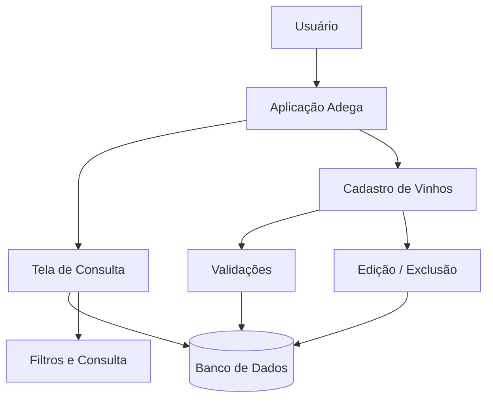

# 🍷 Adega — Sistema de Registro de Vinhos

<p align="center">
  
</p>

<p align="center">
  <strong>Sistema de registro e gerenciamento de vinhos desenvolvido em Low-Code com OutSystems.</strong>
</p>

<p align="center">
  
  
  
</p>

---

## 🍇 Sobre o projeto

**Adega** é uma aplicação desenvolvida para registrar, organizar e consultar informações relacionadas a vinhos.

O projeto foi construído utilizando a abordagem **Low-Code**, com **OutSystems**, buscando demonstrar na prática conceitos de desenvolvimento de aplicações, modelagem de dados, construção de interfaces, regras de negócio e organização de informações.

A ideia é transformar uma coleção de vinhos em uma base organizada, permitindo que cada garrafa tenha suas principais informações registradas e facilmente consultadas.

---

## 🎯 Objetivo

O sistema tem como objetivo facilitar o gerenciamento de uma adega pessoal ou pequena coleção de vinhos.

Entre as informações que podem fazer parte do cadastro estão:

- 🍷 Nome do vinho
- 🏷️ Marca / produtor
- 🌎 País e região
- 🍇 Uva / variedade
- 📅 Safra
- 🏰 Vinícola
- 🍾 Tipo de vinho
- 📦 Quantidade disponível
- 📍 Localização da garrafa
- ⭐ Avaliação
- 📝 Observações

> A estrutura final dos campos pode ser adaptada conforme as entidades e funcionalidades implementadas no projeto.

---

## ✨ Funcionalidades

### 📋 Cadastro de vinhos

Permite registrar os principais dados de cada vinho, criando uma base organizada para consulta.

### 🔎 Consulta de vinhos

Visualização dos vinhos cadastrados de forma estruturada, facilitando a localização das garrafas.

### ✏️ Edição de registros

Possibilidade de atualizar informações de um vinho já cadastrado.

### 🗑️ Exclusão de registros

Permite remover registros que não fazem mais parte da coleção.

### 📊 Organização da coleção

A aplicação pode centralizar informações importantes da adega, permitindo uma visão geral da coleção.

### 🏷️ Classificação

Os registros podem ser organizados por características como tipo, país, região, uva ou safra, de acordo com as regras implementadas.

---

## 🖥️ Interface

A aplicação foi pensada para apresentar as informações de maneira simples, organizada e fácil de utilizar.

### Tela principal

<p align="center">
  
</p>

> **Imagem ilustrativa:** substitua este banner pelas capturas reais das telas do sistema conforme elas forem adicionadas ao repositório.

---

## 🧩 Conceitos de OutSystems utilizados

O projeto foi desenvolvido como exercício prático de **Low-Code Development**, permitindo trabalhar conceitos como:

- Application e Modules
- Screens
- Entities
- Attributes
- Relationships
- Aggregates
- Queries
- Actions
- Client Actions
- Server Actions
- Variables
- Forms
- Tables / Lists
- Widgets
- Validations
- Expressions
- Navigation
- Reusable Components
- CRUD
- Regras de negócio

---

## 🏗️ Arquitetura conceitual



---

## 🔄 Fluxo básico

```text
              ┌──────────────────┐
              │      Usuário      │
              └────────┬─────────┘
                       │
                       ▼
              ┌──────────────────┐
              │  Sistema Adega   │
              └────────┬─────────┘
                       │
          ┌────────────┼────────────┐
          ▼            ▼            ▼
      Cadastrar     Consultar     Editar
          │            │            │
          └────────────┼────────────┘
                       ▼
              ┌──────────────────┐
              │  Base de Vinhos  │
              └──────────────────┘
```

---

## 🛠️ Tecnologias

| Tecnologia | Utilização |
|---|---|
| **OutSystems** | Desenvolvimento da aplicação |
| **Low-Code** | Abordagem de desenvolvimento |
| **OutSystems Service Studio** | Construção e publicação do módulo |
| **Database** | Persistência dos registros |
| **Git / GitHub** | Versionamento e documentação |

---

## 📁 Estrutura sugerida do repositório

```text
Adega/
│
├── README.md
│
├── docs/
│   └── images/
│       ├── adega-banner.svg
│       ├── logo.png
│       ├── tela-principal.png
│       ├── cadastro-vinho.png
│       └── consulta-vinho.png
│
└── [arquivos do projeto OutSystems]
```

### 📸 Organização das imagens

Sugestão para documentar o projeto:

| Arquivo | Conteúdo |
|---|---|
| `logo.png` | Logo oficial do Adega |
| `adega-banner.svg` | Banner ilustrativo |
| `tela-principal.png` | Tela inicial |
| `cadastro-vinho.png` | Cadastro de vinho |
| `consulta-vinho.png` | Consulta/listagem |

---

## 🚀 Como executar

1. Clone ou baixe este repositório.
2. Abra o projeto no ambiente **OutSystems**.
3. Importe o módulo/aplicação correspondente.
4. Configure o ambiente e o banco de dados, se necessário.
5. Publique a aplicação.
6. Acesse a aplicação pelo navegador.
7. Cadastre e consulte os vinhos.

### Requisitos

- Ambiente OutSystems;
- OutSystems Service Studio compatível com a versão do projeto;
- Acesso ao ambiente de desenvolvimento;
- Navegador web.

---

## 🔮 Melhorias futuras

Possíveis evoluções para o sistema:

- [ ] Dashboard da adega
- [ ] Pesquisa por nome
- [ ] Filtros avançados
- [ ] Controle de quantidade em estoque
- [ ] Localização física da garrafa
- [ ] Registro de preço de compra
- [ ] Histórico de consumo
- [ ] Controle de vinhos favoritos
- [ ] Avaliação por estrelas
- [ ] Upload da foto do rótulo
- [ ] Leitura de código de barras/QR Code
- [ ] Relatórios
- [ ] Exportação dos registros
- [ ] Controle de usuários e permissões
- [ ] Responsividade para dispositivos móveis

---

## 📚 Objetivo de aprendizado

O projeto **Adega** faz parte da evolução prática em desenvolvimento **Low-Code com OutSystems**.

Além da construção da interface, o projeto permite exercitar conceitos importantes de desenvolvimento de software, como:

**Modelagem → Dados → Interface → Regras de negócio → CRUD → Validação → Consulta → Evolução**

---

## 👨‍💻 Autor

**Bairon Wykes**

Projeto desenvolvido para **estudo, prática e portfólio profissional** em desenvolvimento Low-Code.

---

## 📌 Observação

Este projeto está em evolução. Novas funcionalidades, melhorias de interface e recursos de gerenciamento podem ser adicionados conforme o desenvolvimento avançar.

---

<p align="center">
  🍷 <strong>Adega</strong> — Organizando sua coleção de vinhos com Low-Code.
</p>
